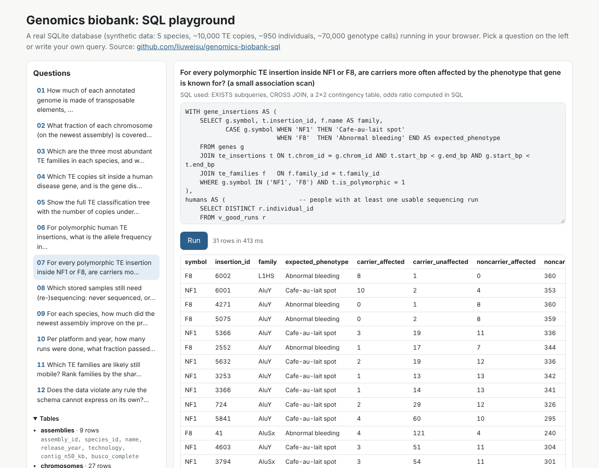
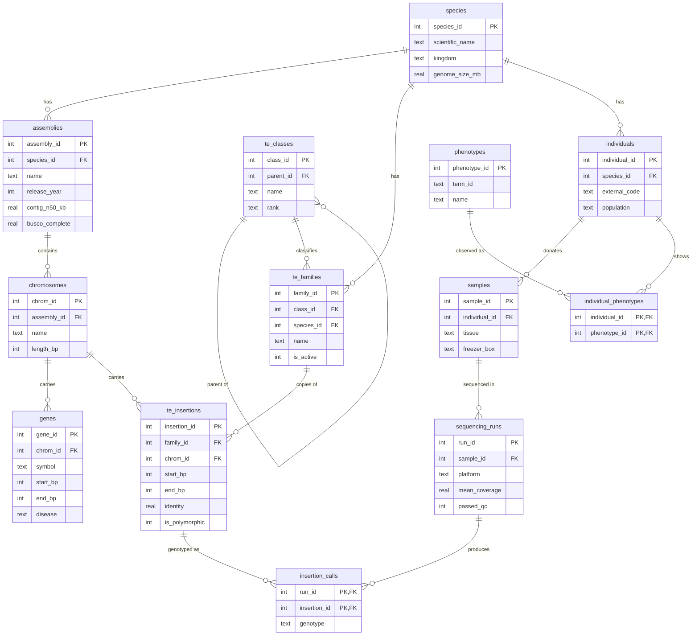

# genomics-biobank-sql

[](https://github.com/liuweisu/genomics-biobank-sql/actions/workflows/ci.yml)
**[Try the SQL playground in your browser](https://liuweisu.github.io/genomics-biobank-sql/)**

A relational database for a genomics lab: reference genomes and their transposable element (TE) annotations on one side, a biobank of people, plants and bacterial isolates with their samples, sequencing runs and genotype calls on the other. Twelve SQL queries answer real questions about it.

During my minor I designed a database as a course project: model the domain, find the relations, then extract information with SQL. This is that exercise again, applied to the field I work in.



## The model



Design decisions worth pointing out:

- **Normalised to third normal form.** A TE family's class is stored once (`te_families.class_id`), not repeated on every one of its copies; `v_te_annotation` joins it back for convenience.
- **Many-to-many relations get their own table** with a composite primary key: `individual_phenotypes` and `insertion_calls`.
- **The TE classification is a tree** (class > order > superfamily, after Wicker et al. 2007) stored as an adjacency list (`parent_id`) and walked with a recursive CTE.
- **Rules the database enforces itself:** foreign keys, `CHECK` constraints (coordinates, genotypes, platforms, percentages), and triggers that reject TE copies running past the end of a chromosome and genotype calls that mix species.
- **Privacy:** individuals only have a pseudonymised `external_code`; no names or contact details are stored.
- **Indexes** on `(chrom_id, start_bp, end_bp)` for interval overlap joins; `tests/` checks with `EXPLAIN QUERY PLAN` that they are used.

## The questions

| # | Question | SQL techniques |
| --- | --- | --- |
| 01 | What share of each genome is TE, by TE order? | joins through a view, conditional aggregation |
| 02 | TE density per chromosome | CTE, joining aggregates |
| 03 | Top three TE families per species | `RANK()` and `SUM() OVER (PARTITION BY ...)` |
| 04 | Young, active TEs inside human disease genes | interval-overlap join |
| 05 | Copies under every node of the classification tree | two recursive CTEs |
| 06 | Population allele frequencies of polymorphic insertions | `ROW_NUMBER()`, pivoting with `CASE`, `HAVING` |
| 07 | Are carriers of an insertion in *NF1*/*F8* more often affected? | `EXISTS`, 2x2 table, odds ratio in SQL |
| 08 | Samples still waiting for (re-)sequencing, with freezer location | `LEFT JOIN` + `HAVING` anti-join |
| 09 | How much did each new assembly improve? | `LAG()` with a named `WINDOW` |
| 10 | Sequencing runs and QC pass rate per platform and year | `strftime`, running totals |
| 11 | Which TE families look recently active? | `NTILE()`, aggregates over booleans |
| 12 | Data quality checks | `UNION ALL` of rule checks |

Query 07 finds the two insertions planted in the data: carriers of an L1 insertion in *F8* (haemophilia A) and of an Alu insertion in *NF1* (neurofibromatosis type 1) are much more often affected than non-carriers. Query 12 finds the nine samples deliberately dated before the donor's consent. With such small groups the odds ratios are rough; in a real study this would go to a proper statistical test.

## Run it locally

```bash
git clone https://github.com/liuweisu/genomics-biobank-sql
cd genomics-biobank-sql
pip install -e ".[dev]"

python -m biobank build            # creates build/biobank.db (~5 MB, takes a second)
python -m biobank list             # the twelve questions
python -m biobank run 07           # run one
python -m biobank sql "SELECT * FROM v_te_annotation LIMIT 5"
pytest
```

Or open `build/biobank.db` in [DB Browser for SQLite](https://sqlitebrowser.org/) or DBeaver. The schema is in [`sql/schema.sql`](sql/schema.sql); apart from the trigger syntax it is standard SQL and moves to PostgreSQL with minor changes.

## About the data

All data are synthetic, made by [`biobank/generate.py`](biobank/generate.py) with a fixed seed. Species, TE family and gene names are real so the queries read naturally, but every coordinate, assembly statistic, person and genotype is generated, assembly names are made up, and chromosomes are scaled down to a few Mb. Phenotype terms are labelled with HPO/TO identifiers for illustration.

## Layout

```
sql/schema.sql        tables, constraints, triggers, indexes, views
queries/*.sql         the twelve analysis queries
biobank/              data generator, Python access layer (read-only, parameterised), CLI
tests/                constraints, triggers, every query, index usage, injection safety
docs/index.html       the browser playground (sql.js), deployed by .github/workflows/pages.yml
```

## License

MIT
